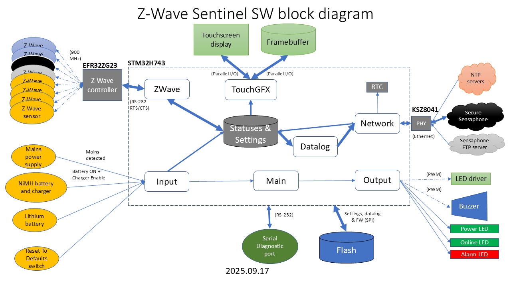

# Z-Wave Sentinel

The Z-Wave Sentinel will monitor Sensaphone Z-Wave wireless sensors, measuring environmental data such as temperature, humidity, contact states, etc. Readings will be periodically logged and periodically transmitted to Sensaphone servers via Ethernet (i.e. wired) connection. Control and programming of the unit will be conducted via web page interface to Sensaphone servers very similar to the web page interface of Sensaphone Sentinel, Sentinel Pro and Stratus EMS. Additional control and information display of Z-Wave Sentinel will also be available at the device via color LCD touchscreen (approximately 4.3" diagonal measure, 272 x 480 pixels 16bpp screen resolution) . Power will be supplied by mains-powered DC supply, with a rechargeable NiMH battery for power backup in case of mains cutoff; a non-rechargeable lithium cell will maintain a real-time clock/calendar and battery-backed memory registers when the Z-Wave Sentinel is powered down.

- A Sensaphone Z-Wave wireless sensor will maintain a datalog of its own, uploading its datalog to the Z-Wave Sentinel periodically. If a Z-Wave wireless sensor loses contact with the Z-Wave Sentinel, the sensor will continue to monitor and save its periodic readings until it is able to re-establish contact with the Z-Wave Sentinel to minimize loss of readings. This does suggest **the combined datalogs the Z-Wave Sentinel uploads to the Sensaphone servers will not be in strict chronological order**.
- Z-Wave Sentinel will periodically send the current UTC time to the Z-Wave sensors. (Perhaps Z-Wave Sentinel should also periodically request the current UTC time from the Z-Wave sensors, to verify the sensors still have the correct time.)

An STMicroelectronics STM32H7 microcontroller will be the main processor of the Z-Wave Sentinel. A Silicon Labs EFR32ZG23 microcontroller configured as an NCP Serial API Controller will be controlled by the STM32H7 over a serial interface to add, delete and monitor remote Sensaphone Z-Wave wireless sensors. Ethernet network connection will use a Microchip KSZ8041 PHY or equivalent.

- STM32H7 development in STMicroelectronics STM32CubeIDE with STM32CubeMX and TouchGFX Designer
- EFR32ZG23 development in Silicon Labs Simplicity Studio IDE
- Source code in C with appropriate SDKs and library packages; reuse and/or adaptation of existing Sensaphone source code when possible

The name "Z-Wave Sentinel" is used informally during development. The product name when released to the public will likely be different.

- We're currently not expecting to apply for official Z-Wave certification, so including the name "Z-Wave" is unlikely. 
- "Wireless Sentinel" or "Sentinel Wireless" might also be an informal name during development.

Performance testing can be done using the GPIO pins designated with the following signals: VSYNC_FREQ - Pin PB6 (D1), RENDER_TIME - Pin PB7 (D0), FRAME_RATE - Pin PG3 (D2), MCU_ACTIVE - Pin PA6 (D3).
